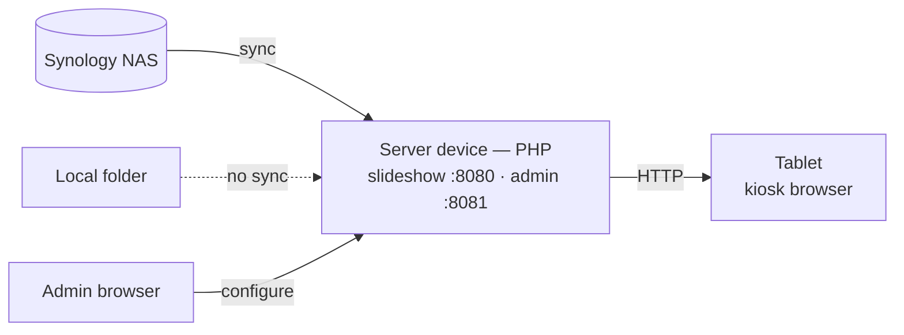

# photoframe — a self-hosted digital photo frame

photoframe turns spare hardware into a wall photo frame. A small set of PHP
scripts runs on an always-on device (for example an old Android phone via
Termux), keeps a local copy of your photos, and serves a full-screen slideshow
that any browser can display. Photos come from a Synology NAS or from a local
folder. Everything runs inside your own network; there is no cloud service and
no account.



## How it works

The work is split across three roles:

- **Source** — where the photos live: a Synology NAS, or a local folder on the
  server device.
- **Server device** — runs the PHP scripts. With a NAS source it syncs photos
  into a size-limited local cache; it then serves a slideshow page (port 8080)
  and a management page (port 8081).
- **Display device** — a tablet (or any screen) running a browser in kiosk mode,
  pointed at the slideshow page.

The server only maintains the local photo set and answers HTTP requests; it does
not push anything. Image requests happen only while a browser has the slideshow
open.

## Features

- **Two sources:** pull from a **Synology NAS** (FileStation API) or serve a
  **local folder**. With a local source nothing is downloaded or deleted.
- **Size-limited cache with rotation** (NAS source): downloads new random
  photos up to a configurable limit and evicts the oldest to make room; can also
  remove local files that no longer exist on the NAS.
- **Folder selection:** restrict the sync to chosen NAS sub-folders; an
  additional album filter limits what is shown.
- **Server-side downscaling** via PHP-GD, cached on disk, with EXIF rotation.
  Falls back to serving originals when GD is not available.
- **Slideshow:** cross-fade transitions, shuffled order, configurable interval.
  Fit modes `blur` (blurred fill behind the photo), `contain`, or `cover`.
- **Overlays:** clock, date, and current weather (Open-Meteo, no API key).
  Overlay text scales with screen size and has an adjustable factor.
- **Web management UI** on a separate port, password-protected. The form is
  generated from the configuration schema, so every option is editable. It can
  test the NAS connection, browse NAS folders, and show recent log lines.
- **Schema-driven configuration:** defaults live in code (`schema.php`), edited
  values in `settings.json`, secrets in `.env`.
- **File logging** with size-based rotation.
- **Helper scripts** to start, stop, and check all processes; optional autostart
  on Termux.

> The on-screen text (weekday and month names, weather words) is currently in
> German; see [Display options](#display-options).

## Requirements

- A device that runs PHP continuously. These instructions use **Termux** on
  Android, but any PHP-capable host works.
- PHP with the **gd** and **exif** extensions (for downscaling and rotation).
  Without gd the originals are served instead.
- A display device with a browser for the slideshow.
- Optional: a Synology NAS reachable over the LAN (only for the `synology`
  source).

---

## 1. Install dependencies (Termux)

```bash
pkg update && pkg upgrade
pkg install php php-gd openssh git
termux-setup-storage        # one-time: grant access to phone storage
```

Check that downscaling support is present:

```bash
php -m | grep -iE 'gd|exif'
```

If `gd` is missing, install `php-gd`. The app still works without it, but serves
full-size originals.

## 2. Access from a PC over SSH (optional)

Convenient for editing files from a computer.

```bash
passwd            # set a password for the Termux user (once)
whoami            # note the user name
sshd              # start the SSH server (port 8022)
```

Connect with an SSH client to `<phone-ip>` on port **8022** using that user name.
`sshd` must be started again after a reboot (the autostart script handles this).

## 3. Get the code

```bash
cd ~
git clone <repository-url> photoframe
cd photoframe
```

To clone over SSH, create a key and add the public part to your Git host:

```bash
ssh-keygen -t ed25519 -C "photoframe"
cat ~/.ssh/id_ed25519.pub
```

Later updates: `git pull`. The non-committed files (`.env`, `settings.json`,
`remote_subdirs.txt`, `photo/`, `logs/`) are left untouched.

## 4. Configuration

### Secrets and location — `.env` (not committed)

```bash
cp .env.example .env
```

Edit `.env`:

```
NAS_USER=your_nas_user
NAS_PASS=your_password
NAS_BASE=https://192.168.1.10:5001    # NAS IP + port (5001 https / 5000 http)
NAS_PIN=sha256//...                   # https only: pinned NAS key, see below
REMOTE_DIR=/photo                     # base folder on the NAS
WEATHER_LAT=52.52
WEATHER_LON=13.41
WEATHER_CITY=                         # optional label
ADMIN_PASS=                           # management UI password (empty = unprotected)
```

For a NAS source, create a dedicated user with **read-only** access to the photo
folder. Inline `# comments` after a value are supported.

**HTTPS with a pinned key.** The NAS certificate is usually self-signed or not
issued for the NAS IP, so a normal certificate check fails. Instead, photoframe
pins the public key of the certificate. Read it once inside your own network and
put the printed line into `.env`:

```bash
php nas_pin.php 192.168.1.10:5001
```

A different key is rejected (`SSL: public key does not match pinned public key`).
The expiry date does not matter, only the key. If you replace the NAS certificate,
run the command again. Without `NAS_PIN` the connection is not verified.

### General settings — schema and `settings.json`

All non-secret options are defined as a **schema** in `config.php` (key, type,
default, help text). Changed values are stored in **`settings.json`** (not
committed). The effective configuration is: schema defaults, overridden by
`settings.json`, overridden by `.env`.

The simplest way to change settings is the [management interface](#management-interface);
every schema option appears there automatically. Important options:

| Option            | Meaning                                                       |
|-------------------|--------------------------------------------------------------|
| `source`          | `synology` or `local`                                        |
| `cache_limit_mb`  | maximum size of the local photo cache                        |
| `refresh_mb`      | how much is swapped per sync run (evict oldest, fetch new)   |
| `sync_hours`      | interval for `php sync.php --loop`                           |
| `cache_keep_days` | drop unused downscaled files after N days                    |
| `interval_ms`     | display time per image                                       |
| `max_width`       | server-side downscale width (0 = original)                   |
| `image_fit`       | `blur`, `contain`, or `cover`                                |
| `ui_scale`        | overlay font size multiplier                                 |
| `show_clock` / `show_date` / `show_weather` | enable the overlays                |

### Source: `synology` or `local`

- **`synology`** (default): `sync.php` downloads photos from the NAS into the
  local cache with the size limit and rotation.
- **`local`**: photos already sit in `photo_dir` (copied or mounted). `sync.php`
  does nothing and deletes nothing — only the web servers run.

### Which folders — `remote_subdirs.txt` (not committed)

```bash
cp remote_subdirs.txt.example remote_subdirs.txt
```

One folder per line, relative to `remote_dir`, each recursive; `#` is a comment:

```
Urlaub2023
Familie
Familie/Familienleben - 2025
```

Empty or comments only means all folders under `remote_dir`. Spaces in names are
allowed; the spelling must match the NAS exactly.

## 5. Run

### With the helper scripts (recommended)

```bash
chmod +x start.sh stop.sh status.sh   # once
./start.sh     # wake-lock + sync loop + slideshow (8080) + admin (8081)
./status.sh    # show what is running
./stop.sh      # stop everything
```

`start.sh` records PIDs in `.run/`, writes output to `logs/*.out`, and refuses to
start twice.

### Manually

```bash
php sync.php                       # sync once (synology source)
php -S 0.0.0.0:8080 -t public      # slideshow
php -S 0.0.0.0:8081 -t admin       # management interface
```

- Slideshow: `http://<server-ip>:8080/`
- `http://<server-ip>:8080/list.php` returns the JSON list of local images.
- `php sync.php --loop` keeps syncing every `sync_hours`.

## Management interface

Runs as a second server with `admin/` as its document root:

```bash
php -S 0.0.0.0:8081 -t admin
```

Open `http://<server-ip>:8081/` from any browser.

- Login with `ADMIN_PASS` from `.env`. If it is empty the UI is unprotected and
  warns you — set a password there first.
- Edits all schema options, the `.env` fields, and `remote_subdirs.txt`.
- Buttons to **test the NAS connection** and **browse NAS folders** (click to add
  a folder to the list). Recent **log lines** are shown at the bottom.

Run it on a trusted LAN only; it edits credentials.

## Tablet / kiosk setup

1. Open the slideshow URL `http://<server-ip>:8080/` in a browser.
2. For a permanent frame, use a kiosk browser (e.g. Fully Kiosk) or Android's
   built-in **screen pinning** plus **Settings → Developer options → Stay awake
   while charging**.
3. LineageOS users can use the built-in **Jelly** browser for a quick test.

## Display options

Configured through the schema (see the table above) and editable in the
management interface. Per-request overrides are possible via the URL, e.g.
`http://<server-ip>:8080/?interval=30000&album=Urlaub2023`.

Aspect ratio: the `blur` fit mode fills the margins with a blurred copy of the
photo, so any aspect ratio looks reasonable. Use `cover` for edge-to-edge with
cropping, or `contain` for the whole image with plain black bars.

On-screen text (weekday/month names, weather words) is currently hard-coded in
German in `index.php`.

## 6. Autostart (Termux:Boot)

Install the **Termux:Boot** app, open it once, and disable battery optimization
for Termux and Termux:Boot. Then:

```bash
mkdir -p ~/.termux/boot
cat > ~/.termux/boot/photoframe.sh <<'EOF'
#!/data/data/com.termux/files/usr/bin/sh
sshd
~/photoframe/start.sh
EOF
chmod +x ~/.termux/boot/photoframe.sh
```

Adjust the path to your project folder.

## Files and version control

Committed: the PHP code — the web root `public/` (`index.php`, `list.php`,
`img.php`), the management UI `admin/`, and the shared backend (`config.php`,
`schema.php`, `nas.php`, `log.php`, `store.php`, `sync.php`) — plus the helper
scripts (including `nas_pin.php`) and `*.example` templates.

The slideshow server uses `public/` as its document root, so the backend files
and the secret/config files (`.env`, `settings.json`, `logs/`, `photo/`) sit
outside the web root and are not reachable over HTTP.

Not committed (per-device / secret): `.env`, `settings.json`,
`remote_subdirs.txt`, `logs/`, `photo/`, `.run/`.

## Logging

`log.php` writes timestamped lines to `logs/app.log`, rotated to `app.log.1` once
it exceeds `log_max_kb`. `sync.php` logs each run; `list.php` and `img.php` log
errors only (not every request); the admin UI logs configuration changes. The
last lines are shown in the management interface.

## Troubleshooting

| Symptom                              | Cause / fix                                                   |
|--------------------------------------|--------------------------------------------------------------|
| Slideshow shows "NAS nicht erreichbar" | server not running, or wrong IP/port in the tablet URL       |
| `list.php` returns `[]`              | `photo/` is empty — run `php sync.php` (synology) or point `photo_dir` at your photos (local) |
| `sync.php`: login failed             | check `.env` credentials and `NAS_BASE` port; 2FA users need a non-2FA account |
| `public key does not match pinned public key` | NAS certificate replaced → `php nas_pin.php <ip>:5001`, update `NAS_PIN` |
| no images from a folder              | spelling in `remote_subdirs.txt` does not match the NAS (case, spaces) |
| images are not downscaled            | `gd` missing → `pkg install php-gd`; otherwise originals are served |
| `sync.php` says nothing to do        | `source` is `local`; set it to `synology` for NAS sync       |
| admin login fails                    | check `ADMIN_PASS` in `.env` (empty = unprotected)           |
| display turns off                    | use `termux-wake-lock` and keep-screen-on in the kiosk browser |
| script: bad interpreter / not found  | line endings — run `sed -i 's/\r$//' *.sh`                   |
